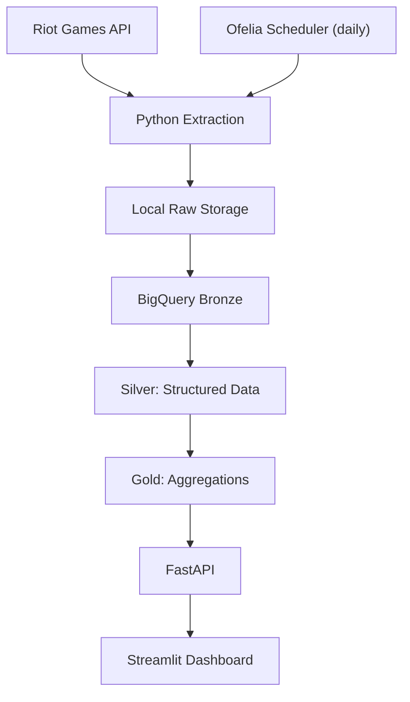
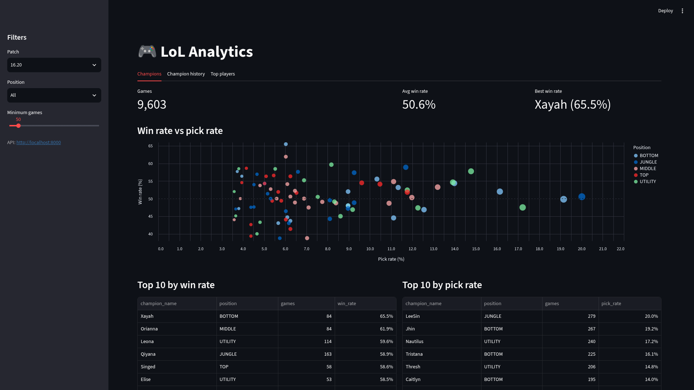

# League of Legends Analytics & Serving Pipeline

End-to-end data engineering project: extracts ranked player and match data for the top 200 players (latest 20 matches each) from the Riot Games API, stores it locally and in Google BigQuery, transforms it through a Bronze–Silver–Gold architecture, and serves results via FastAPI and Streamlit.

## Architecture



| Layer      | Contents                                                        |
| ---------- | --------------------------------------------------------------- |
| **Bronze** | Raw Riot API responses (local files + BigQuery)                 |
| **Silver** | Matches, participants, ranked player snapshots                  |
| **Gold**   | Champion stats (win/pick rate, KDA, CS/min, damage, vision) and player stats, by patch and position |

## Tech Stack

Python, Riot Games API, Google BigQuery, SQL, FastAPI, Streamlit, pytest, Docker, Docker Compose (with Ofelia scheduler).

## Project Structure

```text
.
├── data/                  # Local raw data
├── src/
│   ├── dashboard/app.py   # Streamlit dashboard
│   └── lol_analytics/
│       ├── api.py         # FastAPI app
│       ├── pipeline.py    # extract / load / transform
│       ├── settings.py
│       ├── bronze/        # Raw storage
│       ├── riot/          # API client, extraction, models
│       └── warehouse/     # BigQuery loader, schemas, transforms
├── tests/
├── Dockerfile
├── docker-compose.yml
├── .env.example
└── requirements.txt
```

## Getting Started

**Prerequisites:** Docker with Compose, a Riot Games API key, and a Google Cloud project with BigQuery enabled.

```bash
git clone https://github.com/lukami02/lol-analytics-pipeline.git
cd lol-analytics-pipeline
cp .env.example .env      # fill in your values (no quotes, one KEY=value per line)
docker compose up -d --build
```

Services:

- Dashboard: http://localhost:8501
- API docs: http://localhost:8000/docs

Check status and logs:

```bash
docker compose ps
docker compose logs -f
```

## Running the ETL

A scheduler container runs the full pipeline (`extract` → `load` → `transform`) every day at 12:30 (Europe/Belgrade). To run it manually:

```bash
docker compose exec etl sh -c "python src/lol_analytics/pipeline.py extract && \
  python src/lol_analytics/pipeline.py load && \
  python src/lol_analytics/pipeline.py transform"
```

To change the schedule, edit the `ofelia.job-exec.etl.schedule` label in `docker-compose.yml` (six-field cron, seconds first).

## Tests

```bash
docker compose run --rm --build tests
```

or locally: `pytest -v`. External services are mocked, so no credentials are needed.

## Future Improvements

- Airflow for orchestration and retries
- dbt for versioned SQL transformations
- GitHub Actions CI
- Data quality checks and failure alerting

## Dashboard Preview

